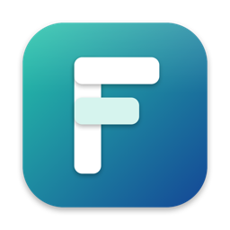

<p align="center"></p>

# Fevom

An open-source alternative to OrbStack. Fevom runs Docker containers and Linux machines in
one lightweight VM on Apple silicon Macs with macOS 26 or later. `fev` is its command-line
tool.

- **Docker**: the real Docker engine, with the pinned `docker` CLI, Compose and Buildx.
  Containers start in about two seconds from a stopped fev, idle at close to no CPU, and
  give their memory and disk space back to the Mac when they no longer need them.
- **Linux machines**: Ubuntu, Debian, Fedora, Arch, Alpine and more, each a full system with
  its own init, reached with `fev run`, `ssh` or a terminal in the app, with your Mac's
  files at the same paths.
- **Your Linux files in Finder**: `~/Fevom` shows every machine, volume, container and image.
- **Names and HTTPS**: every container, Compose service and machine has an address the Mac
  can reach and a name under `fev.local`, with HTTPS from a local root only your user
  trusts.
- **Intel containers**: `docker run --platform linux/amd64` and amd64 machines, through
  FEX-Emu with hardware memory ordering.
- **Debug Shell**: `fev debug CONTAINER` opens a shell with a full tool set inside any
  container or image, even a distroless or stopped one, and leaves it unchanged.
- **Kubernetes**: a single-node cluster beside Docker (`fev k8s start`), using Docker's
  images directly.
- **The app**: containers, images, volumes, machines, builds, networks and the cluster,
  with logs and terminals, in a native macOS app with a menu bar item.

## Install

```sh
curl -fsSL https://github.com/farhanadeem/fevom/releases/latest/download/install.sh | sh
```

It downloads the latest release, checks it, installs Fevom in `/Applications` and opens it.
Fevom keeps itself up to date.

Or download the disk image from the [releases](https://github.com/farhanadeem/fevom/releases)
and drag Fevom to Applications; its `FIRST-OPEN.txt` says how to open it the first time.

Or build and install from this checkout (see [BUILDING.md](BUILDING.md) for what you need):

```sh
tools/install.sh
```

It builds everything, copies `Fevom.app` to `/Applications`, puts `fev` and `docker` on
your `PATH`, and opens the app. `fev uninstall` (or Uninstall Fevom… in the app's menu) takes
it all back (`--delete-data` also deletes your containers, images, volumes and machines).

## Use

```sh
docker run --rm -it alpine     # any docker or docker compose command starts fev
fev create ubuntu dev          # a Linux machine
fev run -m dev uname -a        # a command in it
ssh dev@fev                    # or log in
fev status                     # what is running, and where
fev --help                     # every command
```

More:

- [`~/Fevom`: your Linux files in Finder](docs/user/fev-folder.md)
- [Names and HTTPS](docs/user/names-and-https.md)
- [The admin helper](docs/user/admin-helper.md): reaching containers by their own addresses
- [Proxies](docs/user/proxy.md)
- [Updates](docs/user/updates.md)

## Layout

| Path | What |
|---|---|
| `vmm/` | `fevvm`, the virtual machine monitor (Rust, Hypervisor.framework), and its file server |
| `kernel/` | The guest Linux kernel: the upstream release, fev's patches and configuration |
| `guest/` | `fev-init` and the guest's programs, the system image, the x86 translator's build |
| `host/` | `fevd`, the `fev` CLI, the admin helper and the Mac-side services (Go) |
| `app/` | The macOS app (Swift) |
| `proto/` | The wire protocols between them |
| `tools/` | Build, install, disk image and licence tools |
| `tests/` | The unit-test runner, a smoke test, and the build host the builds run on |

## Licence

Copyright (C) 2026 Farhan Nadeem.

Fevom is free software: you can redistribute it and/or modify it under the terms of the GNU
General Public License as published by the Free Software Foundation, either version 3 of the
License, or (at your option) any later version. See [LICENSE](LICENSE).

The guest kernel and its patches are under GPL-2.0. Every third-party part Fevom includes is
under its own licence; `tools/licenses.sh` collects their texts into the app, and
`inputs.lock` names each one with its version and checksum.

Questions, and requests for source under the GPL: farhannadiim@gmail.com.
